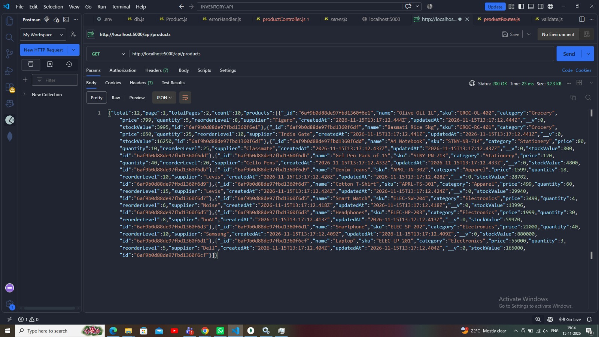
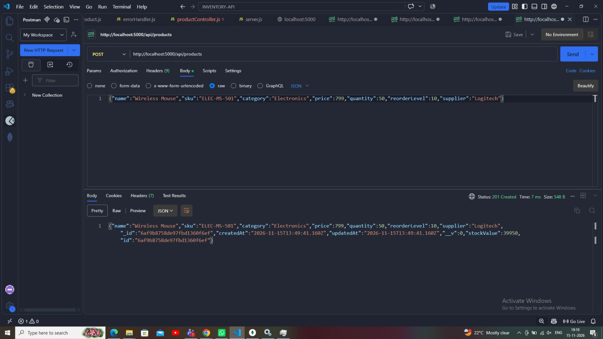
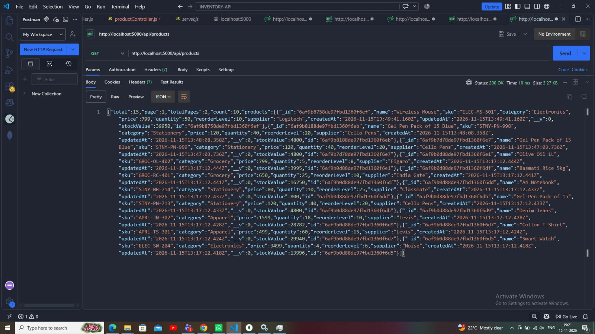
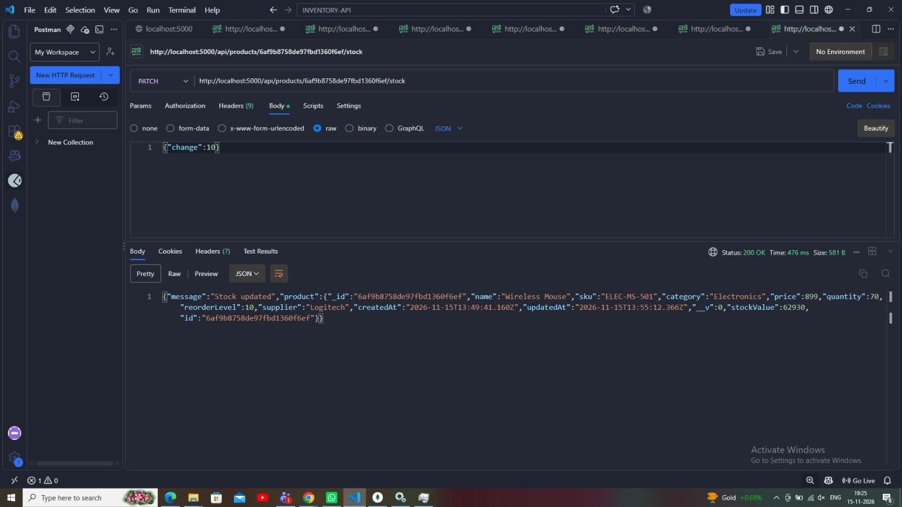
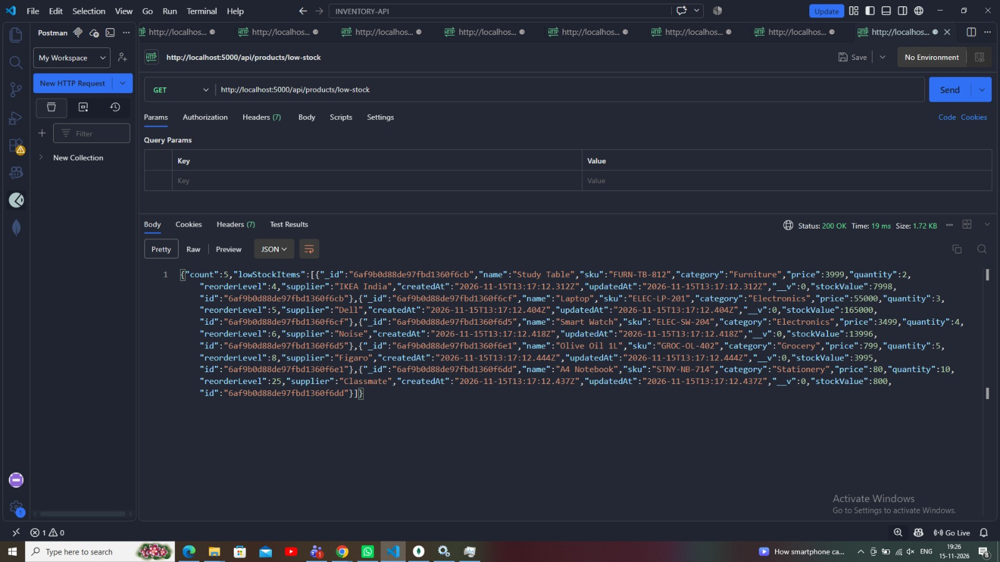
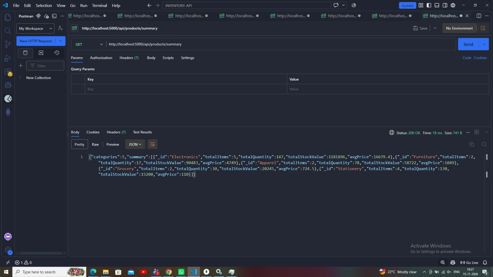
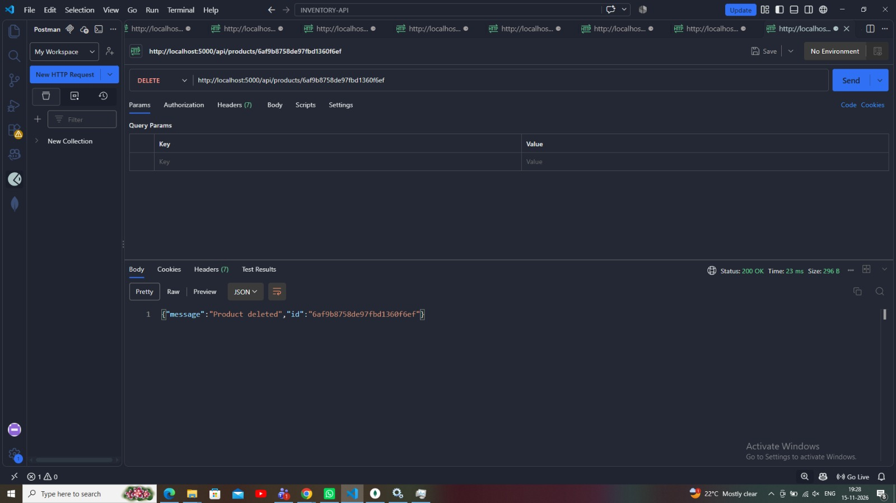

# Inventory and Data Management System

REST API built with Node.js, Express, MongoDB (Mongoose) and dotenv.

## Setup
1. `npm install`
2. Create `.env` with `PORT=5000` and `MONGO_URI=mongodb://127.0.0.1:27017/inventory_db`
3. `npm start`

## API Endpoints
| Method | URL | Purpose |
|---|---|---|
| POST | /api/products | Create product |
| GET | /api/products | Get all (filter, sort, pagination) |
| PUT | /api/products/:id | Update product |
| PATCH | /api/products/:id/stock | Stock adjustment |
| DELETE | /api/products/:id | Delete product |
| GET | /api/products/low-stock | Low-stock report |
| GET | /api/products/summary | Category-wise summary |

## Postman Screenshots

### 1. Get All Products (GET)

### 2. Create Product (POST)

### 3. Get All Products after Create (GET)

### 4. Update Product (PUT)

### 5. Stock Adjustment (PATCH)

### 6. Low-Stock Report (GET)

### 7. Category Summary (GET)

### 8. Delete Product (DELETE)

